# Evidencia de la F4 — Consola de operación

Generada el 2026-11-16 con el propio sistema.

## 1. Pruebas automáticas

```
305 passed
```

## 2. Aceptación (`python -m app.dominio.aceptacion`)

### Evidencia de aceptación — ServicioCerca (F4)

**Resultado:** 4 de 4 escenarios cumplidos.

Red usada: Copia de la red de ejemplo (la red cargada en la consola no se modifica).

#### 1. Consulta normal — Cumplido ✔

La zona se puede atender y el sistema propone la mejor ruta y el técnico que llega primero.

| Paso | Esperado | Obtenido | HTTP | Resultado |
| --- | --- | --- | --- | --- |
| Consultar cobertura de B1 a Z3 (Aranjuez) | Zona cubierta por el camino directo B1 -> Z3, de 1 tramo | Z3 (Aranjuez) es alcanzable desde B1 en 1 tramo(s): B1 -> Z3. | 200 | ✔ |
| Calcular el menor costo de B1 a Z3 | B1 -> Z2 -> Z3 en 15 min; la ruta con menos tramos (B1 -> Z3) cuesta 20 min | Menor costo de B1 a Z3 (Aranjuez): 15 min por B1 -> Z2 -> Z3 (2 tramo(s)). La ruta con menos tramos (B1 -> Z3, 1 tramo(s)) cuesta 20 min, 5 min más. | 200 | ✔ |
| ¿Qué técnico llega primero a Z5 (Robledo)? | Marta, desde B2, en 18 min | Llega primero a Z5 (Robledo): Marta desde B2 (Base Sur), 18 min por B2 -> Z5. | 200 | ✔ |

#### 2. Zona que no existe — Cumplido ✔

Se pide una zona que no está registrada y el sistema responde con un mensaje claro.

| Paso | Esperado | Obtenido | HTTP | Resultado |
| --- | --- | --- | --- | --- |
| Consultar cobertura de B1 a Z99 | Error claro: No existe el nodo 'Z99'. (404) | No existe el nodo 'Z99'. | 404 | ✔ |
| Calcular el menor costo de B1 a Z99 | Error claro: No existe el nodo 'Z99'. (404) | No existe el nodo 'Z99'. | 404 | ✔ |

#### 3. Zona sin conexión — Cumplido ✔

No hay camino hasta la zona: el sistema lo explica en lugar de fallar.

| Paso | Esperado | Obtenido | HTTP | Resultado |
| --- | --- | --- | --- | --- |
| Consultar cobertura de B2 a Z4 (Manrique) | No cubierta; el mensaje explica que la red está desconectada | Z4 (Manrique) no es alcanzable desde B2: no hay camino desde el origen; la red está desconectada entre ambos. | 200 | ✔ |
| Calcular el menor costo de B2 a Z4 | No alcanzable, con el mismo motivo | Z4 (Manrique) no es alcanzable desde B2: no hay camino desde el origen; la red está desconectada entre ambos. | 200 | ✔ |
| ¿Qué técnico llega primero a Z7 (Poblado)? | Z7 no tiene trayectos de llegada; no se puede atender desde ninguna base | Z7 (Poblado) no tiene trayectos que lleguen a ella; no se puede atender desde ninguna base. | 200 | ✔ |

#### 4. Tiempo inválido — Cumplido ✔

Los tiempos en cero o negativos se rechazan al registrar y también al calcular.

| Paso | Esperado | Obtenido | HTTP | Resultado |
| --- | --- | --- | --- | --- |
| Registrar el trayecto B1 -> Z7 con -5 min | Rechazado: el tiempo debe ser mayor que 0; la red queda sin cambios (400) | El tiempo del trayecto debe ser mayor que 0, se recibió -5. | 400 | ✔ |
| Registrar el trayecto B1 -> Z7 con 0 min | Rechazado: el tiempo debe ser mayor que 0; la red queda sin cambios (400) | El tiempo del trayecto debe ser mayor que 0, se recibió 0. | 400 | ✔ |
| Calcular el menor costo con el peso de B1 -> Z1 alterado a 0 fuera de la API | El cálculo se detiene y el error nombra el trayecto B1 -> Z1 (400) | Trayecto B1 -> Z1 inválido para el cálculo de menor costo: El tiempo del trayecto debe ser mayor que 0, se recibió 0. | 400 | ✔ |


## 3. Capturas

| Captura | Qué muestra |
|---|---|
| 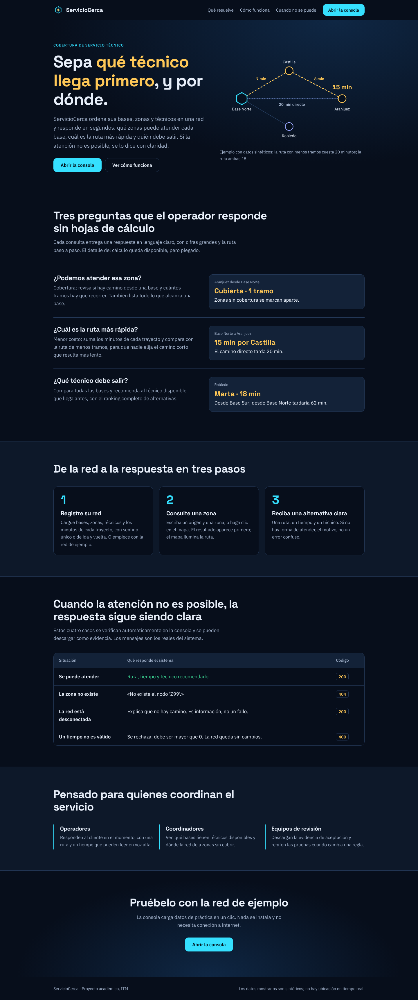 | Landing page |
| 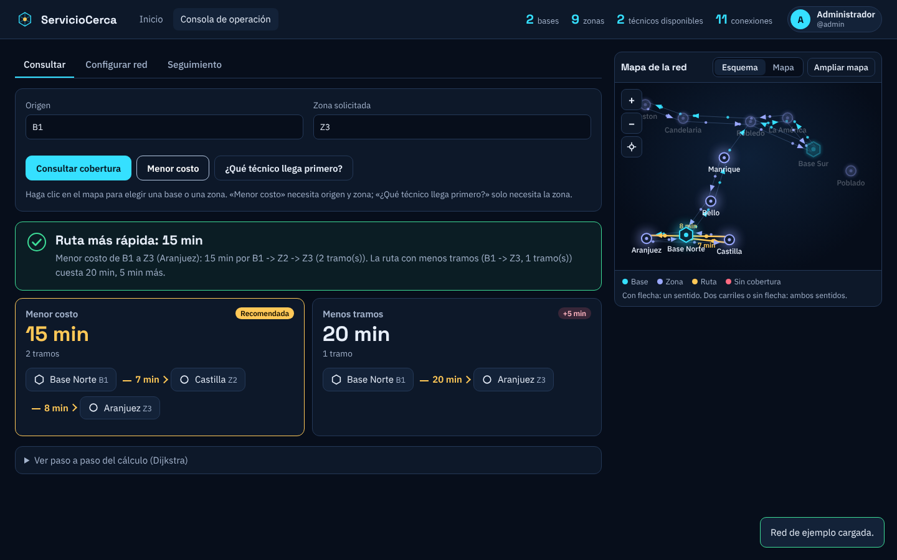 | Menor costo B1 → Z3: 15 min frente a 20 min, con mapa compacto |
| 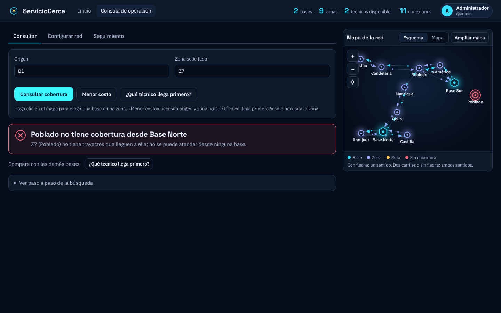 | Zona sin cobertura (Z7) |
| 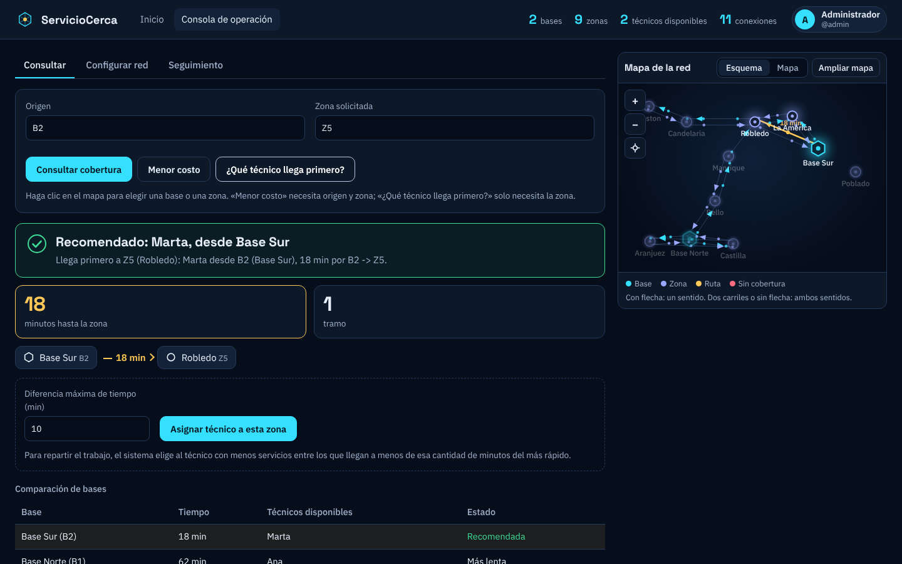 | Técnico que llega primero a Z5 |
| 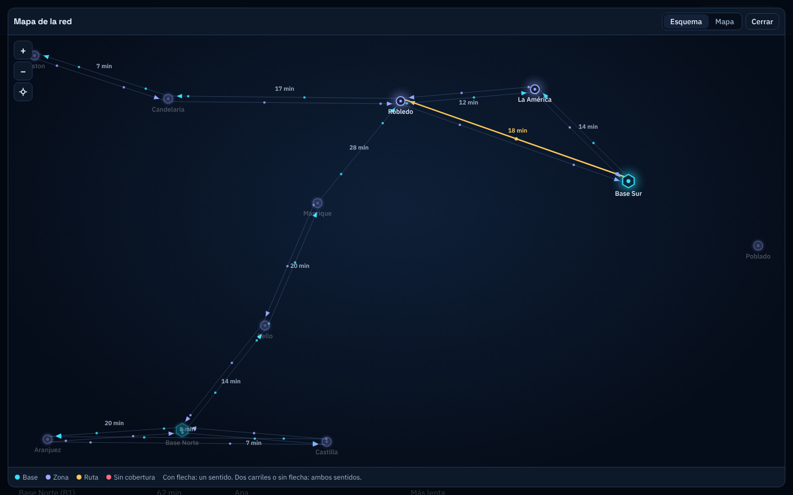 | Mapa ampliado |
| 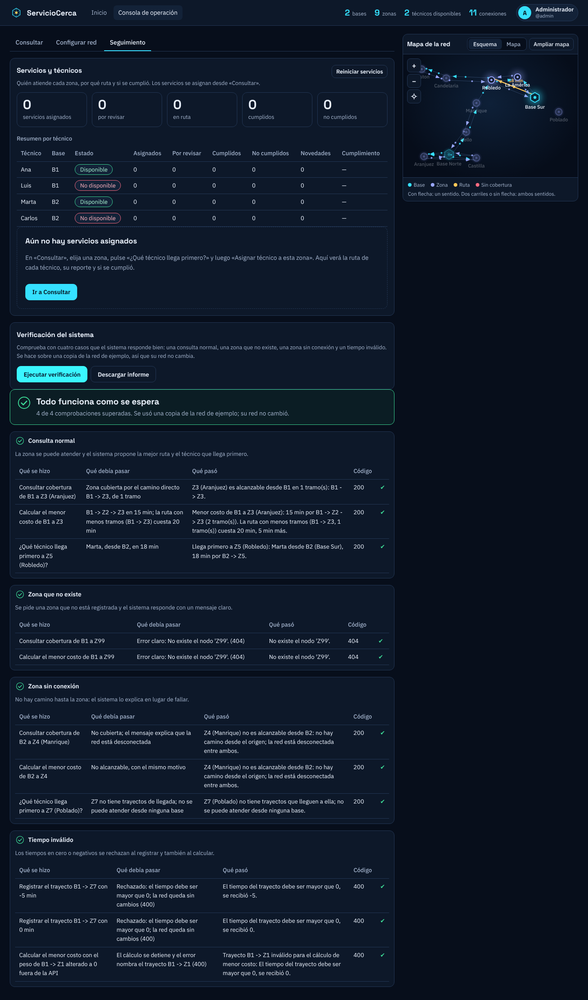 | Seguimiento: verificación del sistema |
| 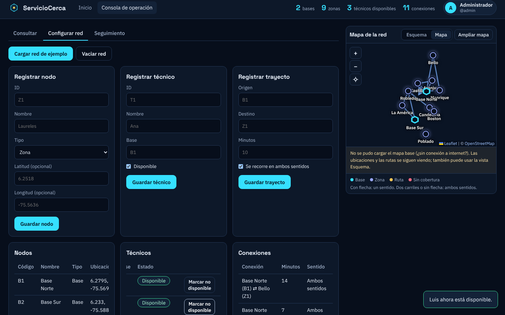 | Disponibilidad de técnicos sin borrarlos |
| 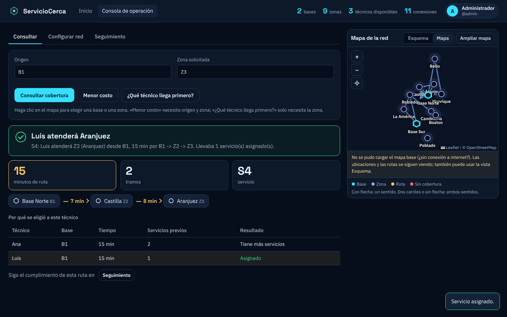 | Asignación equitativa: por qué se eligió a Luis |
| 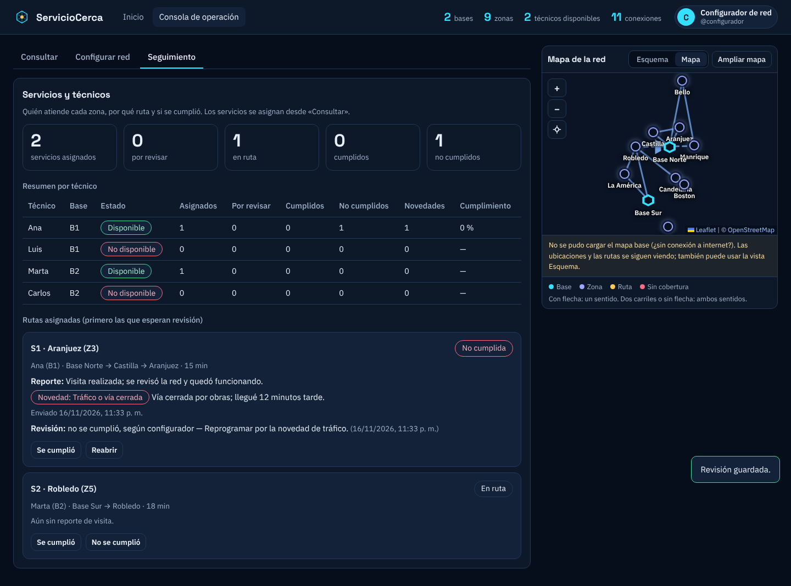 | Seguimiento del revisor: rutas, reporte y decisión |
| 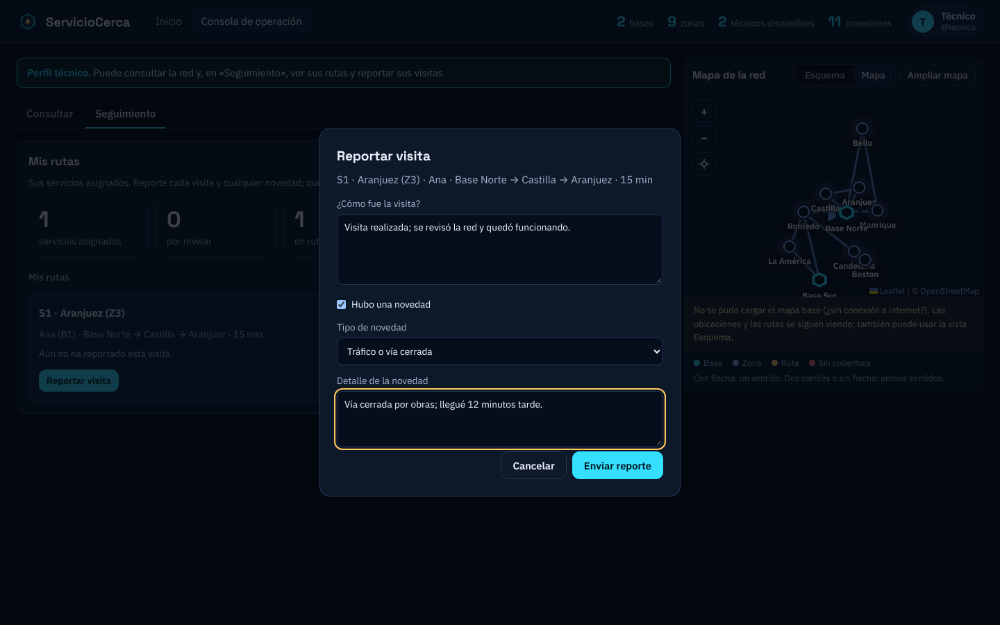 | El técnico reporta la visita y una novedad |
| 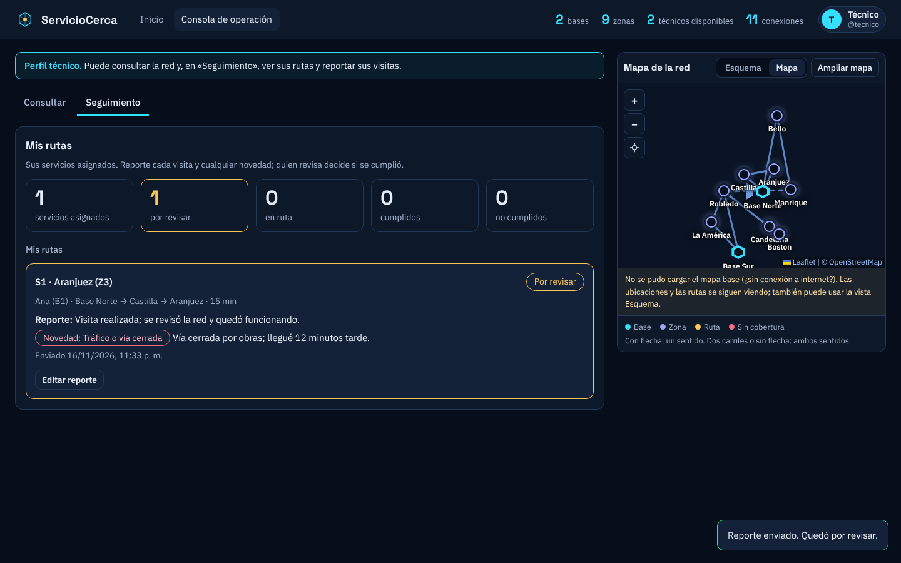 | Mis rutas (perfil técnico) |
| 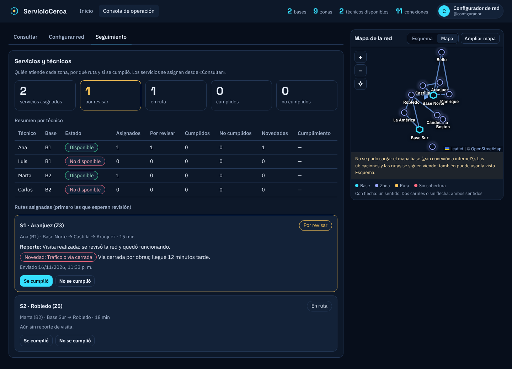 | Servicio por revisar |
| 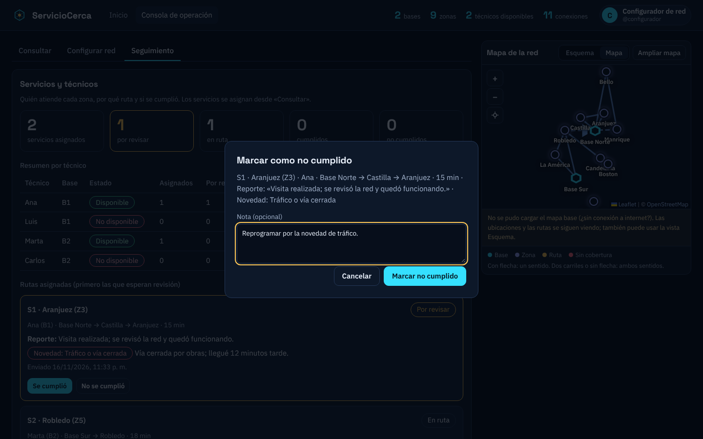 | Decisión del revisor con nota |

## 4. Cambio de requisito docente

El docente no estableció ningún cambio de requisito; no aplica.
